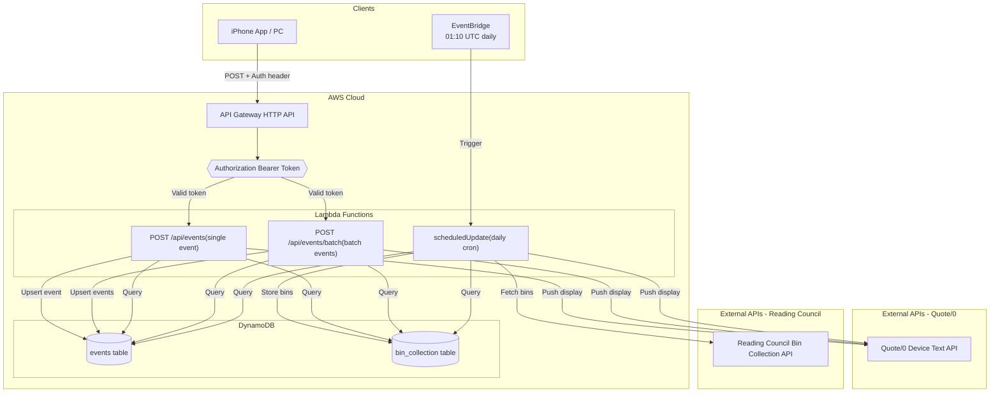

# Quote0 API - Serverless Microservice

A serverless microservice that pushes upcoming events to a Quote/0 reminder device, with automatic bin collection schedule integration using AWS Lambda and DynamoDB.


---

## Quick Start

```bash
# Install dependencies
npm install

# Deploy to AWS
npm run deploy:dev

# View logs
npm run logs
```

**Ready in 10 minutes!** See [QUICKSTART.md](./QUICKSTART.md) for detailed setup.

---

## Features

- **Scheduled Updates** - Automatic push at 01:10 UTC daily
- **Bin Collection Integration** - Reading Council API with DynamoDB storage
- **Event Management** - Create single or batch events via POST endpoints
- **Quote/0 Display** - Push-only architecture via official Quote/0 Text API
- **API Authorization** - Bearer token authentication on all HTTP endpoints
- **Serverless** - AWS Lambda + DynamoDB (pay-per-use)
- **Auto-Scaling** - Handles traffic spikes automatically
- **Cost-Effective** - ~$1.18/month for typical usage

---

## Architecture

> **Push-only system**: Lambda functions actively push updates to Quote/0 via the official Text API. The Quote/0 device does NOT call this API.



---

## API Endpoints

All HTTP endpoints require an `Authorization: Bearer <API_AUTH_TOKEN>` header.

| Method | Endpoint | Description |
|--------|----------|-------------|
| POST | `/api/events` | Create single event and update Quote/0 |
| POST | `/api/events/batch` | Create multiple events (up to 100) and update Quote/0 |
| POST | `/test/scheduled-update` | Manually trigger scheduled update (dev only) |

**Note**: No GET endpoint. This is a push-only architecture.

### Create a Single Event

```bash
curl -X POST https://YOUR-API-URL/api/events \
  -H "Content-Type: application/json" \
  -H "Authorization: Bearer YOUR_API_AUTH_TOKEN" \
  -d '{"date":"2026/02/10","event":"Meeting at 10am"}'
```

### Create Events in Batch

```bash
curl -X POST https://YOUR-API-URL/api/events/batch \
  -H "Content-Type: application/json" \
  -H "Authorization: Bearer YOUR_API_AUTH_TOKEN" \
  -d '{
    "events": [
      {"date": "2026/02/10", "event": "Maths homework p.63"},
      {"date": "2026/02/11", "event": "Doctor 2pm"}
    ]
  }'
```

See [BATCH-EVENTS-GUIDE.md](./BATCH-EVENTS-GUIDE.md) for full batch documentation.

---

## Tech Stack

| Component | Technology | Why |
|-----------|-----------|-----|
| **Runtime** | AWS Lambda (Node.js 18) | Serverless, auto-scaling |
| **Database** | Amazon DynamoDB | No connection management, pay-per-request |
| **Scheduling** | AWS EventBridge | Native cron support, reliable |
| **API** | API Gateway HTTP API | Low latency, cost-effective |
| **External API** | Reading Council Bin API | Public bin collection data |

---

## Project Structure

```
quote0_api/
├── serverless.yml                # AWS infrastructure definition
├── package.json                  # Node.js dependencies
├── QUICKSTART.md                 # 10-minute setup guide
├── BATCH-EVENTS-GUIDE.md         # Batch endpoint documentation
├── src/
│   ├── lambda/
│   │   └── handlers.js           # Lambda function handlers (with auth)
│   └── services/
│       ├── dynamoDbService.js        # DynamoDB operations (events)
│       ├── binCollectionDbService.js  # DynamoDB operations (bin collections)
│       ├── binCollectionService.js    # Reading Council API integration
│       ├── displayFormatterService.js # Quote/0 display formatting
│       ├── quote0ClientService.js     # Quote/0 device communication
│       └── scheduledUpdateService.js  # Scheduled update orchestration
└── docs/
    ├── README.md               # Documentation index
    ├── 01-architecture.md      # System architecture
    ├── 02-api-reference.md     # API documentation
    ├── 03-scheduled-service.md # Scheduling details
    ├── 04-implementation.md    # Implementation guide
    └── 05-deployment.md        # Deployment guide
```

---

## Documentation

- **[Quick Start Guide](./QUICKSTART.md)** - Get running in 10 minutes
- **[Batch Events Guide](./BATCH-EVENTS-GUIDE.md)** - Batch event creation
- **[Architecture](./docs/01-architecture.md)** - System design and components
- **[API Reference](./docs/02-api-reference.md)** - Complete API documentation
- **[Scheduled Service](./docs/03-scheduled-service.md)** - EventBridge configuration
- **[Implementation](./docs/04-implementation.md)** - Development guide
- **[Deployment](./docs/05-deployment.md)** - Production deployment

---

## Development

### Local Testing

```bash
# Install dependencies
npm install

# Run offline (requires serverless-offline)
npm start

# Test endpoints locally (include auth header if API_AUTH_TOKEN is set)
curl -X POST http://localhost:3000/api/events \
  -H "Content-Type: application/json" \
  -H "Authorization: Bearer YOUR_API_AUTH_TOKEN" \
  -d '{"date":"2026/02/10","event":"Test event"}'
```

### Deploy

```bash
# Deploy to development
npm run deploy:dev

# Deploy to production
npm run deploy:prod
```

### Monitoring

```bash
# View logs
npm run logs

# Invoke function manually
npm run invoke

# View DynamoDB data
aws dynamodb scan --table-name quote0-api-dev-events
```

---

## Cost

**Typical monthly cost:**

| Service | Usage | Cost |
|---------|-------|------|
| Lambda | ~1,000 executions, 512MB | $0.37 |
| DynamoDB | ~1,050 requests, < 1GB storage | $0.30 |
| API Gateway | ~1,000 requests | $0.01 |
| CloudWatch | ~5GB logs | $0.50 |
| **Total** | | **~$1.18/month** |

AWS Free Tier covers most of this for the first 12 months.

---

## Scheduled Updates

The service automatically pushes updates to Quote/0 at:

| Time (UTC) | Purpose |
|------------|---------|
| 01:10 | Daily bin collection sync and display update |

Additionally, creating events via `POST /api/events` or `POST /api/events/batch` triggers an immediate Quote/0 update.

**Note:** Time is in UTC. Adjust in `serverless.yml` for your timezone.

---

## Security

- IAM roles with minimal permissions
- DynamoDB encryption at rest
- API Gateway with HTTPS only
- **Bearer token authorization** on all HTTP endpoints (`API_AUTH_TOKEN`)
- Bearer token authentication for outbound Quote/0 API calls (`QUOTE0_AUTH_TOKEN`)
- Environment variables for secrets
- No hardcoded credentials
- CloudWatch logs for audit trail

---

## Environment Variables

| Variable | Description | Example |
|----------|-------------|---------|
| `UPRN` | Your property reference number | `310022781` |
| `QUOTE0_TEXT_API` | Quote/0 device API endpoint | `https://dot.mindreset.tech/api/...` |
| `QUOTE0_AUTH_TOKEN` | Bearer token for Quote/0 device API | `dot_app_...` |
| `API_AUTH_TOKEN` | Bearer token to protect your API endpoints | `your-secret-key` |
| `READING_API_URL` | Reading Council API URL | `https://api.reading.gov.uk/api/collections` |
| `READING_API_TIMEOUT` | API timeout in ms | `5000` |
| `CACHE_TTL_HOURS` | Cache duration | `12` |

---

## DynamoDB Tables

| Table | Purpose | Primary Key |
|-------|---------|-------------|
| `events` | User-created events | `date` (HASH) + `id` (RANGE) |
| `bin_collection` | Bin collection schedules | `date` (HASH) + `service` (RANGE) |

Both tables use TTL for auto-deletion after 90 days.

---

## Roadmap

- [ ] Support multiple Quote/0 devices
- [ ] Web dashboard for event management
- [ ] More external API integrations (weather, calendar)
- [ ] Email/SMS notifications

---

**Built for Quote/0 users**
